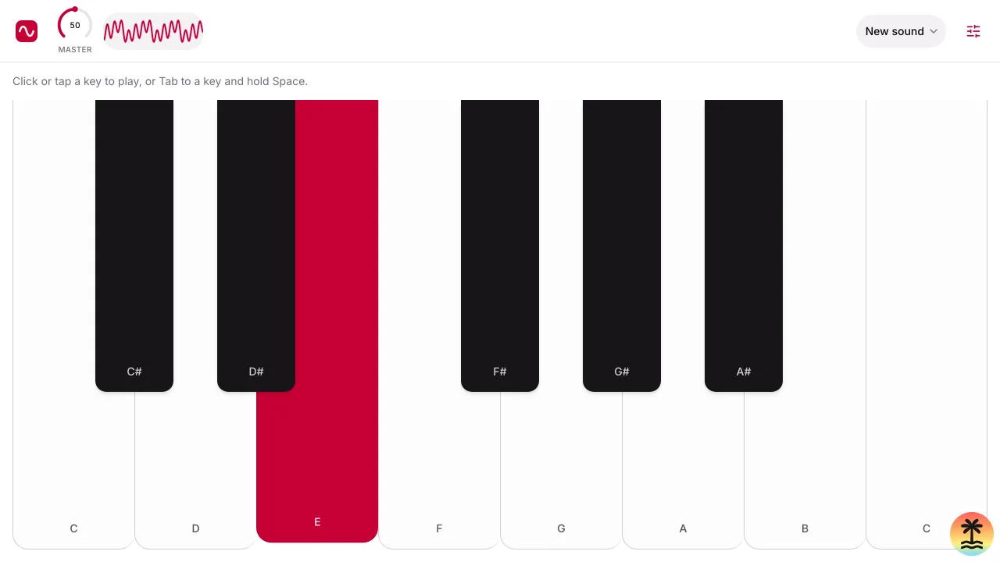

# Vinskiano

A three-oscillator synth that lives in your browser. Free and open source, no install, no sign-up.

**Play it at [vinskiano.app](https://vinskiano.app)**, or go straight to [the synth](https://vinskiano.app/app).

<picture>
  <source srcset="src/assets/screenshots/app-dark-1280.webp" media="(prefers-color-scheme: dark)">
  
</picture>

## What it does

- **Three oscillators**, each with its own waveform (sine, square, triangle or sawtooth), pitch (up to two octaves up or down, in semitones) and volume. Layer them to build a tone. The bar shows one at a time (a select picks which), and each has its own page with larger controls.
- **A 13-key keyboard**, C4 to C5. Play it with a mouse, by touch, or from the keyboard: Tab to a key and hold Space or Enter.
- **A master volume knob and an oscilloscope** that draws what you hear.
- **Presets:** save the sound you made under a name, and load it back later. No sign-up: your first save gives this browser a guest account (a cookie that lasts a year). Clearing cookies or using another browser starts a fresh list.
- **One screen, any device.** The controls fit in a single bar above the keyboard, down to a small phone held sideways. Held upright, a phone turns the synth sideways so the keyboard stays wide.
- **Accessible:** every control has a name for screen readers and works by keyboard (knobs take arrows, Page Up/Down, Home/End). Animations respect reduced motion, and dark mode follows your system.

Not there yet: envelopes, filters and modulation. Vinskiano is meant to grow into a full subtractive synth.

### Browsers

Chrome or Edge 111+, Safari 16.4+ (macOS and iOS), Firefox 128+. On iPhones, sound plays even with the silent switch on.

## Run it locally

You need [Node.js](https://nodejs.org) 26, [pnpm](https://pnpm.io) (the version in `package.json`'s `packageManager` field) and, for presets, [Docker](https://www.docker.com):

```sh
npm install --global pnpm@12.18.0
git clone https://github.com/vindotski/vinskiano.git
cd vinskiano
pnpm install
pnpm exec spotcraft dev start       # Postgres for the presets, in Docker
pnpm exec spotcraft dev env --write # its DATABASE_URL and an AUTH_SECRET, into .env
echo PUBLIC_URL=http://localhost:3000 >> .env
pnpm dev
```

Then open [http://localhost:3000](http://localhost:3000). The synth is at [/app](http://localhost:3000/app). Without the database, `pnpm dev` still plays; only presets don't work. [`.env.example`](.env.example) lists the settings.

### Production build

```sh
pnpm build   # into .output/
pnpm start   # the production server on PORT (default 3000), with the settings from .env
```

The build is a standalone Node server: the home page is prerendered, the synth is rendered on the server and then runs entirely in the browser. All sound is made by the browser's Web Audio API. The only thing the server keeps is the presets you save, in Postgres. The production server won't start without its settings (`DATABASE_URL`, `AUTH_SECRET`, `PUBLIC_URL`).

### With Docker

Nothing but Docker (and the `spotcraft dev` steps above) needed:

```sh
pnpm docker       # or: docker compose up --build app
pnpm docker:dev   # dev server with hot reload, source mounted
```

Both join the local Postgres's Docker network. The production image runs as an unprivileged user, holds only Node and the built server, and has a health check.

vinskiano.app runs on [Spotcraft](https://spotcraft.dev); [docs/deploy.md](docs/deploy.md) has the steps.

## Development

| Command                | What it does                                               |
| ---------------------- | ---------------------------------------------------------- |
| `pnpm dev`             | Dev server with hot reload                                 |
| `pnpm check` / `fix`   | Lint and format check with Biome / apply fixes             |
| `pnpm typecheck`       | TypeScript, strict                                         |
| `pnpm test`            | Unit tests (Vitest)                                        |
| `pnpm test:e2e`        | Browser tests (Playwright) against a production build      |
| `pnpm test:e2e:docker` | The same browser tests against the Docker image            |
| `pnpm verify`          | All of the above except Docker; run it before opening a PR |
| `pnpm screenshots`     | Recapture the app screenshots (start the app first)        |

Browser tests run in Chromium, Firefox and WebKit, and on phones held both ways. The first run needs the browsers: `pnpm exec playwright install`. The tests that touch presets (and the database unit tests) need the local Postgres from `pnpm exec spotcraft dev start`.

**Built with** [TanStack Start](https://tanstack.com/start) (React 19, TanStack Router, server rendering with Nitro), TypeScript, Postgres with [Drizzle](https://orm.drizzle.team) and [Spotcraft's backend kit](https://spotcraft.dev) for the guest accounts, [Tailwind CSS](https://tailwindcss.com) with [shadcn/ui](https://ui.shadcn.com) on [React Aria](https://react-spectrum.adobe.com/react-aria/), [Motion](https://motion.dev), and the Web Audio API.

**Where things are:** `src/music/` is plain music theory (notes, scales), `src/audio/` the Web Audio engine, `src/components/` the UI, `src/routes/` the pages, `src/server/` the server-only code (guest accounts, the presets' table and migrations). [AGENTS.md](AGENTS.md) describes the architecture and conventions in detail; it's written for coding agents and works just as well for people.

## Contributing

Issues and pull requests are welcome.

1. Fork the repository and branch off `dev` (`main` is what's released).
2. Make your change, with a test where it fits. For a bug, add a test that fails without the fix.
3. Run `pnpm verify`.
4. Commit with a [Conventional Commits](https://www.conventionalcommits.org) message, like `fix(ui): …` or `feat(audio): …`.
5. Open a pull request against `dev`. CI runs the same checks, plus the Docker image.

## License and credits

Made by [Ivan Vinski](https://www.vin.ski) ([ivan@vin.ski](mailto:ivan@vin.ski)).

Licensed under the Apache License 2.0. See [LICENSE](LICENSE) and [NOTICE](NOTICE). Release history is in [CHANGELOG.md](CHANGELOG.md).
