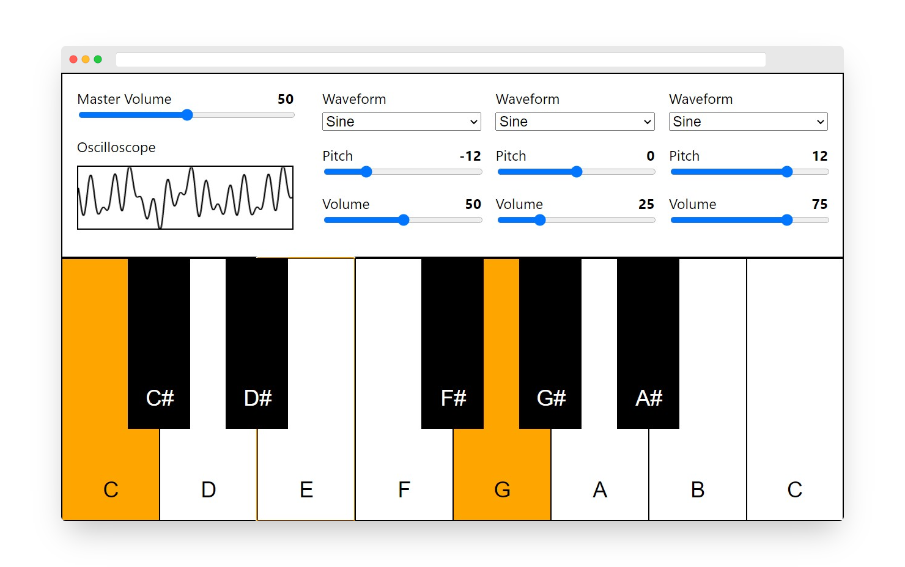

# Vinskiano

> Browser-based subtractive synthesizer

Vinskiano is a browser-based subtractive synthesizer in the making. For now,
Vinskiano consists of 1 master gain control and 3 customizable oscillators. You can
change the waveform, pitch and gain of each individual oscillator. What's missing
right now and will be included in future versions of Vinskiano are functionalities
such as ADSR envelopes, modifiers, modulation, et cetera.



## Features

- Keyboard with 13 keys (C4-C5)
- Customizable root key (only via code)
- 3 customizable oscillators
  - Waveform: Sine, Square, Triangle, Sawtooth
  - Pitch: From -24 to 24 semitones
  - Volume: From 0 to 100 percent
- Master volume control
- Oscilloscope that shows output waveform
- Forced landscape orientation
- Responsive layout (fills viewport)

## Development setup

### Instructions

#### 1. Clone the repository

```
git clone https://github.com/ivanvinski/vinskiano.git
cd vinskiano
```

#### 2. Install dependencies

```
yarn install
```

#### 3. Start for development

```
yarn start
```

#### 4. Open your browser and navigate to [`http://localhost:3000`](http://localhost:3000)

## Production build

#### 1. Build project files

```
yarn build
```

#### 2. Serve content

Serve files in `build` directory.

## Scripts

* `yarn start` - starts project for development
* `yarn build` - builds project for production

## Release History

- **0.1.0** - December 15, 2020

See [CHANGELOG.md](CHANGELOG.md) for more information.

## Meta

[Ivan Vinski](https://ivanvinski.com) – contact@ivanvinski.com

Distributed under the GPL-2.0 license. See [LICENSE.txt](LICENSE.txt) for more information.

https://github.com/ivanvinski/vinskiano

## Contributing

1. Fork it (<https://github.com/ivanvinski/vinskiano/fork>)
2. Create your feature branch (`git checkout -b feature/fooBar`)
3. Commit your changes (`git commit -am 'Add some fooBar'`)
4. Push to the branch (`git push origin feature/fooBar`)
5. Create a new Pull Request
